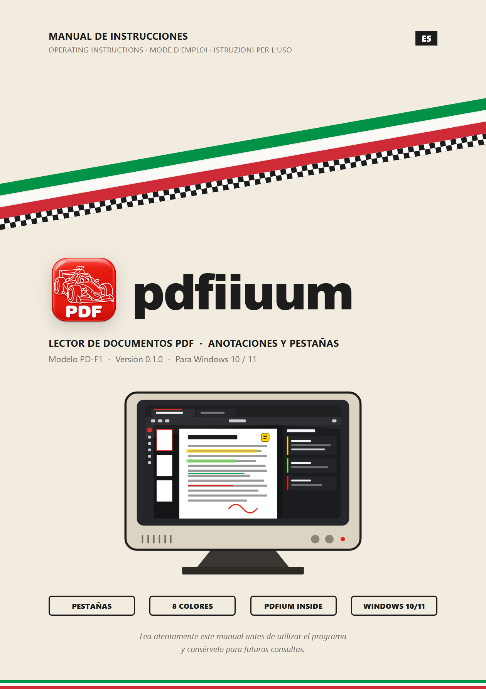
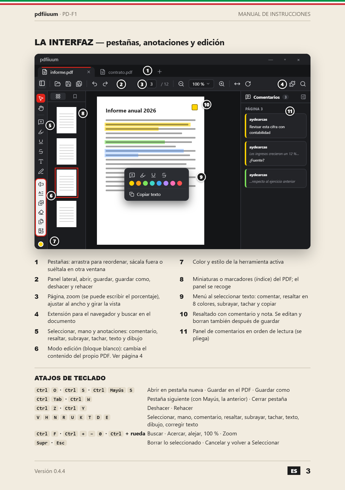

<p align="center">
  
</p>

<h1 align="center">pdfiiuum</h1>

<p align="center">
  Lee, resalta y comenta tus PDF en pestañas, y guarda las anotaciones dentro del propio PDF.<br>
  <sub>A fast and simple PDF reader for Windows with tabs, highlights and comments.</sub>
</p>

<p align="center">
  <a href="LICENSE"></a>
  
  
  <a href="https://github.com/aydearcas/pdfiiuum/releases/latest"></a>
</p>

<p align="center">
  
  &nbsp;
  
  <br><sub>Al estilo de los manuales de instrucciones de los 80–90.</sub>
</p>

---

pdfiiuum es un lector de PDF de escritorio para Windows, ligero y con interfaz oscura. Abre varios PDF en pestañas; permite resaltar, subrayar, tachar, comentar, insertar texto y dibujar; y guarda las anotaciones dentro del propio PDF como anotaciones estándar, legibles en Acrobat, Edge o Chrome.

## Descarga

1. Descarga `pdfiiuum_<versión>_x64-setup.exe` desde [**Releases**](https://github.com/aydearcas/pdfiiuum/releases/latest).
2. Ábrelo y elige la carpeta de instalación (por defecto `C:\Program Files\pdfiiuum`). Pide permiso de administrador una sola vez.
3. La primera vez Windows puede mostrar «Windows protegió su PC», porque el instalador no está firmado: pulsa **Más información → Ejecutar de todas formas**.
4. Para abrir los PDF con doble clic: clic derecho en un PDF → **Abrir con → Elegir otra aplicación → pdfiiuum → Siempre**.

### Extensión para Edge, Chrome y Brave

Añade un botón **Abrir en pdfiiuum** (y la misma opción en el menú del botón derecho sobre una página o un enlace) que descarga el PDF con tu sesión del navegador, lo guarda en **Descargas** y lo abre en pdfiiuum. Funciona también con PDF que piden iniciar sesión y con PDF locales (`file://`).

1. Instala pdfiiuum (el instalador deja la extensión en `C:\Program Files\pdfiiuum\extension` y la conecta con la app).
2. Abre `edge://extensions` (o `chrome://extensions`, `brave://extensions`) y activa **Modo de desarrollador**.
3. Pulsa **Cargar desempaquetada** y elige la carpeta `extension` de la instalación.
4. Para los PDF locales, en los detalles de la extensión activa **Permitir el acceso a las URL de archivo**.

El icono muestra ✓ cuando el PDF se ha abierto y ! si algo ha fallado (al pasar el ratón por encima se ve el motivo).

## Funciones

- Pestañas: reordenar arrastrando, sacar una pestaña a una ventana nueva o moverla a otra ventana.
- Anotaciones: resaltado en 8 colores, subrayado, tachado, notas, texto insertado y dibujo a mano alzada, con deshacer y rehacer.
- Menú al seleccionar texto (comentar, resaltar, subrayar, tachar, copiar).
- Panel lateral con todos los comentarios y resaltados del documento, en orden de lectura. El autor es el usuario de Windows.
- Búsqueda, miniaturas, zoom y giro de la vista.
- Instalador para Windows que registra pdfiiuum en «Abrir con» y en Aplicaciones predeterminadas, y una sola instancia: los PDF abiertos desde el Explorador entran como pestañas.
- Lápiz digital: dibuja con cualquier herramienta, borra con la goma o el botón lateral y agrupa los trazos de cada palabra.
- Extensión del navegador «Abrir en pdfiiuum».
- Modo edición (solo escritorio): **Corregir texto** (E) reescribe una línea del PDF con su tipografía, tamaño, color y posición. Si la tipografía incrustada no tiene alguna letra, esa letra se escribe con una parecida (Helvetica, Times, Courier o, para otros alfabetos, Arial, Times New Roman o Courier New) y se avisa. No recoloca el párrafo, no edita texto girado ni escaneado.
  - **Añadir texto al PDF** como contenido (no como anotación), en Sans, Serif o Mono, con el color y el tamaño de la herramienta de texto.
  - **Insertar imagen** (PNG, JPEG, GIF, BMP o WebP; el JPEG va sin recomprimir) y **mover, cambiar el tamaño o borrar imágenes** del PDF.
  - **Tapar una zona**: rectángulo blanco que además quita el texto y las imágenes que quedan enteros debajo (lo que queda tapado solo en parte sigue en el PDF: no es un borrado seguro).

## Tecnología

Tauri 2 (Rust) + React + TypeScript. [pdf.js](https://github.com/mozilla/pdf.js) muestra las páginas y [PDFium](https://pdfium.googlesource.com/pdfium/), mediante [`pdfium-render`](https://github.com/ajrcarey/pdfium-render), escribe las anotaciones al guardar.

## Requisitos para compilar (una vez)

```powershell
winget install --id Microsoft.VisualStudio.2022.BuildTools --override "--quiet --wait --add Microsoft.VisualStudio.Workload.VCTools --includeRecommended"
winget install --id Rustlang.Rustup
```

Cierra y vuelve a abrir la terminal después de instalar Rust. También hace falta Node.js 20 o posterior.

## Comandos

| Comando | Qué hace |
|---|---|
| `npm install` | Instala dependencias |
| `npm run dev` | Solo la interfaz, en el navegador (http://localhost:1420). Sin guardado de anotaciones |
| `npm run tauri dev` | App de escritorio en modo desarrollo |
| `npm run release` | Genera el instalador en `src-tauri/target/release/bundle/nsis/` sin rutas del equipo dentro del ejecutable (úsalo para publicar) |
| `npm run tauri build` | Igual, pero el ejecutable conserva las rutas locales de compilación |
| `npx tauri icon ruta/al/icono.png` | Regenera todos los iconos (PNG de 1024×1024) |
| `powershell -File scripts\render-docs.ps1` | Regenera las imágenes del manual (`docs/*.png`) desde `docs/manual/*.html` con Edge |

## Estructura

- `src/` — interfaz (React). `lib/platform.ts` separa lo de escritorio de lo de navegador.
- `src/components/DocTab.tsx` — una pestaña: visor, anotaciones, historial y guardado.
- `src/lib/annotations.ts` — modelo de anotaciones pendientes (coordenadas PDF).
- `src-tauri/src/pdf_engine.rs` — escritura de anotaciones con PDFium.
- `src-tauri/src/windows.rs` — varias ventanas, mover pestañas e instancia única.
- `src-tauri/windows/hooks.nsh` — registro del instalador como lector de PDF y del puente con la extensión.
- `src-tauri/src/pdf_edit.rs` — modo edición: tramos de texto de cada página y su corrección con PDFium.
- `src-tauri/src/native_host.rs` — puente con la extensión: Edge o Chrome arrancan `pdfiiuum.exe chrome-extension://…` y le pasan el PDF por mensajería nativa.
- `browser-extension/` — extensión «Abrir en pdfiiuum». Su identificador (`ehgjjipbmdcgnpmfclngigpianjmnalh`) sale de la clave pública `key` de `manifest.json` y debe coincidir con `allowed_origins` en `src-tauri/windows/native-messaging-host.json`. La clave privada no está en el repositorio: solo hace falta para publicarla en la Chrome Web Store con el mismo identificador.

## Licencia

pdfiiuum se distribuye bajo la licencia [GPL-3.0](LICENSE).

Componentes de terceros incluidos:

- `src-tauri/lib/pdfium.dll` — compilación oficial de [bblanchon/pdfium-binaries](https://github.com/bblanchon/pdfium-binaries) (versión 158.0.8111), licencia BSD-3-Clause ([`src-tauri/lib/PDFIUM-LICENSE`](src-tauri/lib/PDFIUM-LICENSE)). Se incluye en el instalador.
- pdf.js (Apache-2.0), Tauri y `pdfium-render` (MIT/Apache-2.0), React (MIT) y Lucide (ISC) se obtienen como dependencias con sus propias licencias.
