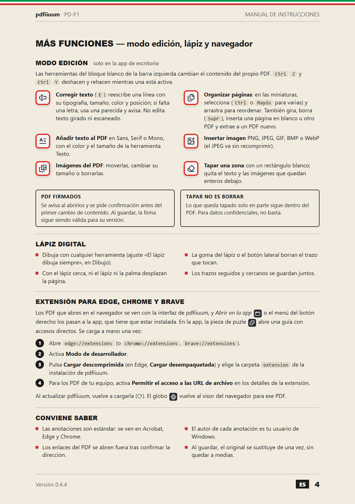

<p align="center">
  
</p>

<h1 align="center">pdfiiuum</h1>

<p align="center">
  Lee, resalta y comenta tus PDF en pestañas, y guarda las anotaciones dentro del propio PDF.<br>
  <sub>A fast and simple PDF reader for Windows with tabs, highlights, comments and PDF editing.</sub>
</p>

<p align="center">
  <a href="LICENSE"></a>
  
  
  <a href="https://github.com/aydearcas/pdfiiuum/releases/latest"></a>
</p>

<p align="center">
  
  &nbsp;
  
  &nbsp;
  
  <br><sub>Al estilo de los manuales de instrucciones de los 80–90.</sub>
</p>

---

pdfiiuum es un lector de PDF de escritorio para Windows, ligero y con interfaz oscura. Abre varios PDF en pestañas; permite resaltar, subrayar, tachar, comentar, insertar texto y dibujar, también con lápiz digital; y guarda las anotaciones dentro del propio PDF como anotaciones estándar, legibles en Acrobat, Edge o Chrome. Con el modo edición corrige el texto del PDF, añade texto e imágenes y organiza las páginas, y con su extensión los PDF que abres en el navegador se ven con la misma interfaz.

## Descarga

1. Descarga `pdfiiuum_<versión>_x64-setup.exe` desde [**Releases**](https://github.com/aydearcas/pdfiiuum/releases/latest).
2. Ábrelo y elige la carpeta de instalación (por defecto `C:\Program Files\pdfiiuum`). Pide permiso de administrador una sola vez.
3. La primera vez Windows puede mostrar «Windows protegió su PC», porque el instalador no está firmado ([por qué y cómo se firmaría](docs/firma-de-codigo.md)): pulsa **Más información → Ejecutar de todas formas**. Puedes comprobar el archivo con el SHA-256 que aparece en las notas de cada versión.
4. Para abrir los PDF con doble clic: clic derecho en un PDF → **Abrir con → Elegir otra aplicación → pdfiiuum → Siempre**.

### Extensión para Edge, Chrome y Brave

- **Visor de pdfiiuum en el navegador**: los PDF que abres en Edge, Chrome o Brave se muestran con la interfaz de pdfiiuum (pestañas, miniaturas, anotaciones, lápiz y modo edición). Guardar escribe en el archivo que elijas. Lo que necesita PDFium (leer y guardar anotaciones, editar, organizar páginas) lo hace la app instalada a través de la extensión, así que hace falta tener pdfiiuum instalado.
  - En la ventana de la extensión se desactiva para volver al visor del navegador; el botón del globo del visor lo hace solo para ese PDF.
  - Si el servidor pide descargar el PDF, se respeta la descarga.
- **Abrir en la app de pdfiiuum** (ventana de la extensión, menú del botón derecho sobre una página o un enlace, o el botón del visor): descarga el PDF con tu sesión del navegador, lo guarda en **Descargas** y lo abre en la app. Funciona también con PDF que piden iniciar sesión y con PDF locales (`file://`).

En pdfiiuum, el botón de la pieza de puzle (arriba a la derecha) abre una guía con botones para abrir la página de extensiones de cada navegador instalado y la carpeta de la extensión. Los navegadores no dejan que un programa instale extensiones de fuera de su tienda, así que se carga a mano una vez:

1. Instala pdfiiuum (el instalador deja la extensión en `C:\Program Files\pdfiiuum\extension` y la conecta con la app).
2. Abre `edge://extensions` (o `chrome://extensions`, `brave://extensions`) y activa **Modo de desarrollador**.
3. Pulsa **Cargar descomprimida** (en Edge, **Cargar desempaquetada**) y elige la carpeta `extension` de la instalación.
4. Para los PDF locales, en los detalles de la extensión activa **Permitir el acceso a las URL de archivo**.

Al actualizar pdfiiuum, vuelve a cargar la extensión (botón ⟳ en la página de extensiones) o reinicia el navegador.

Para desarrollar: `npm run build:extension` compila el visor en `browser-extension/viewer/` (también lo hace `npm run build`); después se puede cargar `browser-extension` como extensión desempaquetada.

## Funciones

### Leer

- Pestañas: reordenar arrastrando, sacar una pestaña a una ventana nueva o moverla a otra ventana.
- Panel izquierdo con miniaturas o marcadores (índice) del PDF.
- Búsqueda, zoom (se puede escribir el porcentaje), ajustar al ancho y giro de la vista. Los PDF se abren al 100 %.
- Los enlaces del PDF se abren en el navegador o el programa de correo después de confirmarlos, sin sacar la ventana de pdfiiuum.

### Anotar

- Resaltado en 8 colores, subrayado, tachado, notas, texto insertado y dibujo a mano alzada, con deshacer y rehacer. Las anotaciones que ya están guardadas en el PDF se pueden editar y borrar.
- Menú al seleccionar texto: comentar, resaltar, subrayar, tachar y copiar.
- Panel lateral con todos los comentarios y resaltados del documento, en orden de lectura. El autor es el usuario de Windows.
- Lápiz digital: dibuja con cualquier herramienta, borra con la goma o el botón lateral y agrupa los trazos de cada palabra.

### Editar el PDF (solo en la app de escritorio)

- **Corregir texto** (E): reescribe una línea del PDF con su tipografía, tamaño, color y posición. Si la tipografía incrustada no tiene alguna letra, esa letra se escribe con una parecida (Helvetica, Times, Courier o, para otros alfabetos, Arial, Times New Roman o Courier New) y se avisa. No recoloca el párrafo ni edita texto girado o escaneado.
- **Añadir texto al PDF** como contenido (no como anotación), en Sans, Serif o Mono, con el color y el tamaño de la herramienta de texto.
- **Insertar imagen** (PNG, JPEG, GIF, BMP o WebP; el JPEG va sin recomprimir) y **mover, cambiar el tamaño o borrar imágenes** del PDF.
- **Tapar una zona**: rectángulo blanco que además quita el texto y las imágenes que quedan enteros debajo. Lo que queda tapado solo en parte sigue en el PDF: no es un borrado seguro.
- **Organizar páginas**: en las miniaturas se seleccionan páginas (Ctrl o Mayús para varias) y se arrastran para reordenarlas; también se giran, se borran (Supr), se inserta una página en blanco u otro PDF detrás y se extraen a un PDF nuevo. Las anotaciones sin guardar se escriben antes en el PDF para que sigan en su página.
- Ctrl+Z / Ctrl+Y deshacen y rehacen los cambios del modo edición mientras está activa una de sus herramientas.
- PDF con firma digital: se avisa al abrirlos, se pide confirmación antes del primer cambio de contenido y se guardan de forma incremental, sin invalidar la firma.

### Windows y navegador

- Instalador para Windows que registra pdfiiuum en «Abrir con» y en Aplicaciones predeterminadas, y una sola instancia: los PDF abiertos desde el Explorador entran como pestañas.
- Extensión para Edge, Chrome y Brave: visor de pdfiiuum en el navegador y «Abrir en la app de pdfiiuum» (ver [arriba](#extensión-para-edge-chrome-y-brave)).

## Tecnología

Tauri 2 (Rust) + React + TypeScript. [pdf.js](https://github.com/mozilla/pdf.js) muestra las páginas y [PDFium](https://pdfium.googlesource.com/pdfium/), mediante [`pdfium-render`](https://github.com/ajrcarey/pdfium-render), escribe las anotaciones al guardar y hace los cambios del modo edición.

## Seguridad

La versión 0.4.4 ha pasado una auditoría de seguridad del software (24 y 25 de octubre de 2026) sobre la app de escritorio, la extensión del navegador y su puente con la app, el instalador, las dependencias y el historial del repositorio. Es una revisión propia, no una certificación externa.

Qué se revisó:

- **Archivos no confiables**: cómo llegan los PDF a pdf.js y a PDFium desde la app, el navegador, la línea de órdenes y el puente de la extensión.
- **Comunicación entre la interfaz y Rust**: los 16 comandos de la app, las rutas que aceptan y la política de seguridad de contenido (CSP).
- **Extensión y native messaging**: qué webs pueden llegar al visor, qué acepta el puente y con qué límites.
- **Instalador y desinstalador**: registro, permisos y que al desinstalar solo se borre lo de pdfiiuum.
- **Pérdida de datos y privacidad**: guardado atómico, PDF firmados, enlaces externos y conexiones salientes (no hay ninguna: ni telemetría ni recursos remotos).
- **Dependencias y secretos**: `npm audit` sin avisos, crates principales al día, ningún secreto en el código ni en el historial.

Resultado: 8 hallazgos (1 alto, 3 medios y 4 bajos), ninguno crítico. Siete están corregidos y comprobados con pruebas automáticas (`cargo test`), en la app compilada y en el visor del navegador:

| Severidad | Hallazgo | Corrección |
|---|---|---|
| Alta | Una web podía hacer que la app procesara un PDF con PDFium sin ningún clic | El visor no carga dentro de otras páginas y solo pasa el PDF a la app cuando el usuario anota, edita o guarda |
| Media | Los enlaces de un PDF navegaban dentro de la ventana de la app | Se abren fuera tras confirmarlos (solo http, https y mailto) |
| Media | Sin CSP y con comandos que aceptaban cualquier ruta | CSP estricta; los comandos solo aceptan PDF (e imágenes al insertarlas) |
| Media | Guardar un PDF firmado invalidaba la firma | Guardado incremental y aviso |
| Baja | El puente aceptaba rutas de red (`file://servidor/…`) | Solo PDF en unidades locales |
| Baja | Sin proceso para mantener PDFium al día | `scripts/update-pdfium.mjs`, con comprobación del SHA-256 |
| Baja | Sin límite de tamaño en el visor y el puente | Límite de 1 GB |

**Pendiente:** la firma de código del instalador. Se hará con SignPath Foundation; el proceso y los requisitos están en [docs/firma-de-codigo.md](docs/firma-de-codigo.md). Mientras tanto, comprueba el instalador con el SHA-256 de las notas de cada versión.

## Requisitos para compilar (una vez)

```powershell
winget install --id Microsoft.VisualStudio.2022.BuildTools --override "--quiet --wait --add Microsoft.VisualStudio.Workload.VCTools --includeRecommended"
winget install --id Rustlang.Rustup
```

Cierra y vuelve a abrir la terminal después de instalar Rust. También hace falta Node.js 20 o posterior.

## Comandos

| Comando | Qué hace |
|---|---|
| `npm install` | Instala dependencias |
| `npm run dev` | Solo la interfaz, en el navegador (http://localhost:1420). Sin guardado de anotaciones |
| `npm run tauri dev` | App de escritorio en modo desarrollo |
| `npm run release` | Genera el instalador en `src-tauri/target/release/bundle/nsis/` sin rutas del equipo dentro del ejecutable (úsalo para publicar) |
| `npm run tauri build` | Igual, pero el ejecutable conserva las rutas locales de compilación |
| `node scripts/update-pdfium.mjs` | Comprueba si hay una PDFium más nueva (hazlo antes de publicar: cada versión corrige fallos de seguridad). Con un número (`… 8200`) la descarga, comprueba su SHA-256 y sustituye `src-tauri/lib/pdfium.dll` |
| `npx tauri icon ruta/al/icono.png` | Regenera todos los iconos (PNG de 1024×1024) |
| `powershell -File scripts\render-docs.ps1` | Regenera las imágenes del manual (`docs/*.png`) desde `docs/manual/*.html` con Edge (actualiza ahí el número de versión al publicar) |

## Estructura

- `src/` — interfaz (React). `lib/platform.ts` separa lo de escritorio de lo de navegador.
- `src/components/DocTab.tsx` — una pestaña: visor, anotaciones, historial y guardado.
- `src/lib/annotations.ts` — modelo de anotaciones pendientes (coordenadas PDF).
- `src-tauri/src/pdf_engine.rs` — lectura y escritura de anotaciones con PDFium.
- `src-tauri/src/windows.rs` — varias ventanas, mover pestañas e instancia única.
- `src-tauri/windows/hooks.nsh` — registro del instalador como lector de PDF y del puente con la extensión.
- `src-tauri/src/pdf_edit.rs` — modo edición: tramos de texto e imágenes de cada página y sus cambios con PDFium.
- `src-tauri/src/pdf_pages.rs` — modo edición: girar, borrar, mover, insertar y extraer páginas.
- `src-tauri/src/native_host.rs` — puente con la extensión: Edge o Chrome arrancan `pdfiiuum.exe chrome-extension://…` y le pasan el PDF por mensajería nativa.
- `browser-extension/` — extensión: visor (`viewer/`, compilado desde `src/` con `vite.extension.config.ts`), redirección de los PDF y «Abrir en pdfiiuum». El visor llama a PDFium a través de `src/lib/bridge.ts` y la sesión de `native_host.rs`. Su identificador (`ehgjjipbmdcgnpmfclngigpianjmnalh`) sale de la clave pública `key` de `manifest.json` y debe coincidir con `allowed_origins` en `src-tauri/windows/native-messaging-host.json`. La clave privada no está en el repositorio: solo hace falta para publicarla en la Chrome Web Store con el mismo identificador.

## Licencia

pdfiiuum se distribuye bajo la licencia [GPL-3.0](LICENSE).

Componentes de terceros incluidos:

- `src-tauri/lib/pdfium.dll` — compilación oficial de [bblanchon/pdfium-binaries](https://github.com/bblanchon/pdfium-binaries) (versión 158.0.8111), licencia BSD-3-Clause ([`src-tauri/lib/PDFIUM-LICENSE`](src-tauri/lib/PDFIUM-LICENSE)). Se incluye en el instalador.
- pdf.js (Apache-2.0), Tauri y `pdfium-render` (MIT/Apache-2.0), React (MIT) y Lucide (ISC) se obtienen como dependencias con sus propias licencias.
